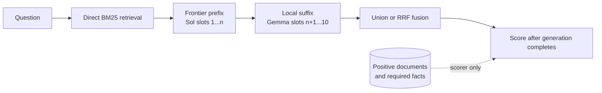
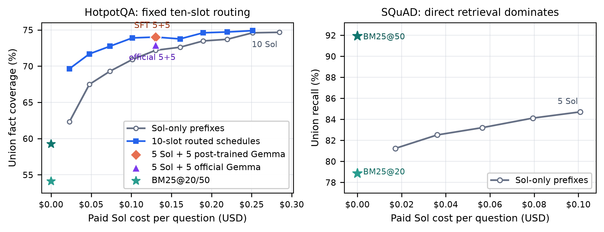

# Delegent

<h3 align="center">
Fixed-Schedule Model Routing for Cost-Effective Search
</h3>

<p align="center">
  <strong>Paper coming soon</strong> |
  <a href="#quick-start"><strong>Quick Start</strong></a> |
  <a href="#how-delegent-works"><strong>Method</strong></a> |
  <a href="#results"><strong>Results</strong></a> |
  <a href="REPRODUCING.md"><strong>Reproduce</strong></a>
</p>

<p align="center">
  
  <a href="LICENSE"></a>
  
</p>

Delegent is a controlled framework for routing search actions between a frontier model and a local small language model. The frontier model performs the early decomposition and search actions; a post-trained Gemma 4 E4B continues from the same retrieval history. A direct BM25 query is shared across systems and sits outside the generated-call budget.

On 366 projected HotpotQA questions, five GPT-5.6 Sol searches followed by five post-trained Gemma searches reach **74.016% union fact coverage**, compared with **74.672%** for ten Sol searches, while reducing measured paid Sol cost by **54.2%**. On the frozen 3,741-question SQuAD selection split, a single wider BM25 retrieval is stronger than every tested Sol-only trajectory, showing that effective routing must also decide when *not* to invoke another model.

## How Delegent Works



For a ten-search cap, a routed policy is a deterministic schedule

$$
\pi_{n,m} = [\underbrace{S,\ldots,S}_{n},\underbrace{G,\ldots,G}_{m}],
\qquad n+m=10.
$$

Every routed HotpotQA run copies the direct retrieval and first \(n\) searches from the canonical AllSol10 record exactly, then generates only the remaining Gemma suffix. The prompt, output schema, corpus, retrieval settings, evidence windows, and fusion rule remain fixed.

Generation is qrel-blind: neither actor receives qrels, reference answers, future Sol searches, or evaluation metrics. Before opening qrels, the scorer validates a completion manifest against the arm, question count, and cryptographic identity of the finished record set. See [the evaluation protocol](docs/evaluation-protocol.md) for the full contract.

The evaluated local actor freezes `google/gemma-4-E4B-it` and adds a rank-16 LoRA adapter trained with next-token supervision. Training examples are qrel-blind Sol search steps from HotpotQA questions disjoint from the evaluation holdout and randomly sampled BrowseComp-Plus questions. The official checkpoint without the adapter is evaluated under the same prompt and serving contract. This initial code release covers routing, prefix reuse, split freezing, and aggregate scoring; post-training code and checkpoint distribution are not yet included.

## Quick Start

```bash
git clone https://github.com/castorini/Delegent.git
cd Delegent

python -m venv .venv
source .venv/bin/activate
python -m pip install --upgrade pip
python -m pip install -e ".[test]"

python -m pytest -q
python scripts/run_routed_family.py \
  --config examples/demo_config.json \
  --dry-run
```

The dry run validates synthetic canonical records and all configured schedules, hashes the first delegate prompt for each schedule, and performs no model, retrieval, or file-writing calls. A live run additionally requires a canonical AllSol10 record set, a BM25 endpoint, and an OpenAI-compatible Gemma endpoint. Credentials belong in environment variables, never in configuration files. See [REPRODUCING.md](REPRODUCING.md) for the staged workflow and [`configs/hotpotqa-c10.json`](configs/hotpotqa-c10.json) for the secret-free HotpotQA template.

## Results

Both benchmarks are projected onto the fixed `fineweb-edu-100b-karpathy` corpus. HotpotQA uses 366 held-out multi-hop questions. SQuAD reports the frozen 3,741-question selection split after excluding an independent eight-question pilot.

<p align="center">
  
</p>

### HotpotQA fixed ten-slot routing

Union fact is macro coverage over the deduplicated retrieval union. RRF@20 is required-fact coverage after reciprocal-rank fusion with \(k=60\). Sol cost is the aggregate API-equivalent cost over 366 questions; savings are relative to AllSol10. Local Gemma inference is estimated separately at roughly 1/200 of Sol inference and rounds to $0.00 at the table's precision.

| System | Union fact | RRF@20 | Sol cost | Savings |
|---|---:|---:|---:|---:|
| BM25@20 | 54.112 | 54.112 | $0.00 | 100.0% |
| BM25@50 | 59.253 | 54.112 | $0.00 | 100.0% |
| 1 Sol + 9 Gemma | 69.645 | 65.638 | $8.38 | 92.0% |
| 2 Sol + 8 Gemma | 71.689 | 68.502 | $17.46 | 83.2% |
| 3 Sol + 7 Gemma | 72.750 | 69.153 | $26.88 | 74.2% |
| 4 Sol + 6 Gemma | 73.898 | 70.642 | $37.07 | 64.4% |
| **5 Sol + 5 Gemma** | **74.016** | **71.102** | **$47.72** | **54.2%** |
| 5 Sol + 5 Gemma (official base) | 72.901 | 69.645 | $47.72 | 54.2% |
| 6 Sol + 4 Gemma | 73.761 | 71.553 | $58.84 | 43.5% |
| 7 Sol + 3 Gemma | 74.604 | 70.961 | $69.32 | 33.5% |
| 8 Sol + 2 Gemma | 74.718 | 71.453 | $80.37 | 22.9% |
| 9 Sol + 1 Gemma | 74.900 | 71.599 | $91.92 | 11.8% |
| 10 Sol + 0 Gemma (AllSol10) | 74.672 | 71.394 | $104.21 | 0.0% |
| 10 Gemma (post-trained) | 63.925 | 58.438 | $0.00 | 100.0% |
| 10 Gemma (official base) | 62.855 | 57.482 | $0.00 | 100.0% |

The 5+5 point retains 99.12% of AllSol10 union fact coverage and is the least expensive tested schedule above 74.0%. This is an empirical operating point on the evaluated set, not a guarantee for unseen tasks. Machine-readable values are in [`results/hotpotqa.csv`](results/hotpotqa.csv).

### SQuAD direct retrieval and Sol prefixes

Union recall is the percentage of selection questions retrieving at least one positive document. Recall is evaluated on 3,741 selection questions, while the Sol cost column reflects generation across all 7,490 supported trajectories used to materialize the prefix records.

| System | Union recall | Sol cost |
|---|---:|---:|
| BM25@20 | 78.856 | $0.00 |
| **BM25@50** | **91.927** | **$0.00** |
| AllSol1 | 81.235 | $128.31 |
| AllSol2 | 82.518 | $270.28 |
| AllSol3 | 83.213 | $423.50 |
| AllSol4 | 84.122 | $594.72 |
| AllSol5 | 84.710 | $754.78 |

BM25@50 may return 50 passages, whereas the five-call Sol trajectory returns at most 45. The supported conclusion is therefore narrow: on this selection split and metric, one wider direct retrieval is stronger than the tested generated-query trajectories. Machine-readable values are in [`results/squad.csv`](results/squad.csv).

## Repository

| Path | Purpose |
|---|---|
| [`src/delegent/`](src/delegent/) | Reusable record, schedule, prefix-reuse, and scoring contracts |
| [`scripts/`](scripts/) | Dry-run validation, routed generation, prefix derivation, split freezing, aggregate scoring, and frontier-cost accounting CLIs |
| [`configs/`](configs/) | Secret-free public experiment configurations |
| [`tests/`](tests/) | Unit tests for contracts, routing invariants, and metrics |
| [`results/`](results/) | Aggregate-only released tables; no QIDs, traces, or qrels |
| [`docs/`](docs/) | Evaluation and contamination-control protocol |
| [`assets/`](assets/) | README figures |

## Reproducibility and Data Release

The repository intentionally does **not** contain benchmark qrels, reference answers, benchmark question IDs, raw model responses, OAuth state, service credentials, checkpoints, or private run receipts. Public scripts separate qrel-blind generation from post-completion scoring, validate exact prefix reuse before admitting a routed record, and summarize paid frontier cost without emitting QIDs.

Start with [REPRODUCING.md](REPRODUCING.md). Benchmark and checkpoint distribution instructions will be added as their release locations are finalized.

## Citation

Citation information will be added with the paper release.

## License

Delegent is released under the [Apache License 2.0](LICENSE).
