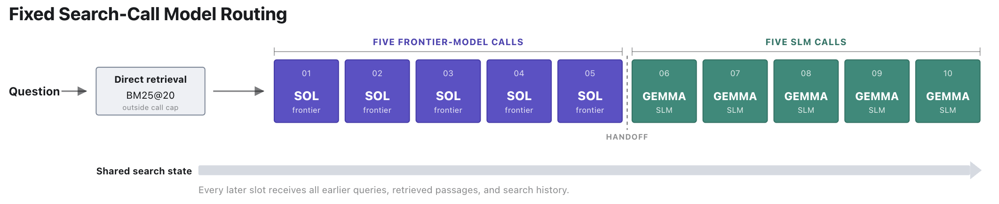
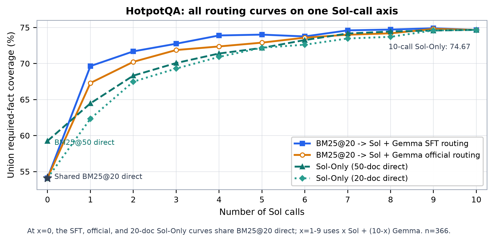
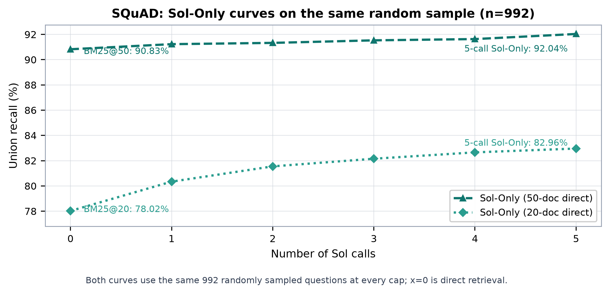

# Delegent

<h3 align="center">
Fixed-Schedule Model Routing for Cost-Effective Search
</h3>

<p align="center">
  <strong>Paper coming soon</strong> |
  <a href="README.md#quick-start"><strong>Quick Start</strong></a> |
  <a href="README.md#how-delegent-works"><strong>Method</strong></a> |
  <a href="README.md#results"><strong>Results</strong></a> |
  <a href="REPRODUCING.md"><strong>Reproduce</strong></a>
</p>

<p align="center">
  
  <a href="LICENSE"></a>
  
</p>

Delegent is a controlled framework for routing search actions between a frontier model and a local small language model. The frontier model performs the early decomposition and search actions; a post-trained Gemma 4 E4B continues from the same retrieval history. A direct BM25 query is shared across systems and sits outside the generated-call budget.

On 366 projected HotpotQA questions, five GPT-5.6 Sol searches followed by five post-trained Gemma searches reach **74.016% union fact coverage**, compared with **74.672%** for ten Sol searches, while reducing measured paid Sol cost by **54.2%**. The official Gemma checkpoint reaches **72.901%** under the same 5+5 schedule, showing that routing remains useful without post-training and improves further with it. On the same randomly sampled 992 SQuAD questions, 50-document direct retrieval starts at **90.827%** union recall and five Sol calls reach **92.036%**, so this easier setting is already near saturation.

## How Delegent Works

<p align="center">
  
</p>

For a ten-search cap, a routed policy is a deterministic schedule

$$
\pi_{n,m} = [\underbrace{S,\ldots,S}_{n},\underbrace{G,\ldots,G}_{m}],
\qquad n+m=10.
$$

We use **Sol-Only** for a schedule in which every generated search call is assigned to Sol. Every routed HotpotQA run copies the direct retrieval and first \(n\) searches from the canonical ten-call Sol-Only record exactly, then generates only the remaining Gemma suffix. The prompt, output schema, corpus, retrieval settings, evidence windows, and fusion rule remain fixed.

Generation is qrel-blind: neither actor receives qrels, reference answers, future Sol searches, or evaluation metrics. Before opening qrels, the scorer validates a completion manifest against the arm, question count, and cryptographic identity of the finished record set. See [the evaluation protocol](docs/evaluation-protocol.md) for the full contract.

The evaluated local actor freezes `google/gemma-4-E4B-it` and adds a rank-16 LoRA adapter trained with next-token supervision. Its model messages contain Sol search steps but no qrels or answers; early HotpotQA-source rows were selected with training-only qrel metrics. The evaluation holdout is disjoint from training, and the official checkpoint without the adapter uses the same prompt and serving contract. The release includes the exact historical stage trainers, a simpler reviewed training implementation, the effective final-stage configuration, and aggregate lineage; it does not include the cumulative input adapter, raw trajectories, or final checkpoint.

## Quick Start

From the root of a clone or downloaded ZIP of this repository:

```bash
python -m venv .venv
source .venv/bin/activate
python -m pip install --upgrade pip
python -m pip install -e ".[test]"

python -m pytest -q
python scripts/run_routed_family.py \
  --config examples/demo_config.json \
  --dry-run
```

The dry run validates synthetic canonical records and all configured schedules, hashes the first delegate prompt for each schedule, and performs no model, retrieval, or file-writing calls. A live run additionally requires a canonical ten-call Sol-Only record set, a BM25 endpoint, and an OpenAI-compatible Gemma endpoint. Credentials belong in environment variables, never in configuration files. See [REPRODUCING.md](REPRODUCING.md) for the staged workflow and [`configs/hotpotqa-c10.json`](configs/hotpotqa-c10.json) for the secret-free HotpotQA template.

## Results

Both benchmarks are projected onto the fixed `fineweb-edu-100b-karpathy` corpus. HotpotQA uses 366 held-out multi-hop questions. SQuAD uses the same randomly sampled 992 questions for every direct-retrieval depth and Sol-call prefix.

### HotpotQA fixed ten-slot routing

<p align="center">
  
</p>

Union fact is macro coverage over the deduplicated retrieval union. RRF@20 is required-fact coverage after reciprocal-rank fusion with \(k=60\). Sol cost is the aggregate API-equivalent cost over 366 questions; savings are relative to ten-call Sol-Only with 20-document direct retrieval. Gemma's quoted uncached-input and output rates are 1/200 of Sol's corresponding rates; the paper's primary curve treats locally served Gemma inference as $0.00.

| Schedule | Union fact SFT | Union fact official | RRF@20 SFT | RRF@20 official | Sol cost | Savings |
|---|---:|---:|---:|---:|---:|---:|
| 0 Sol + 10 Gemma | 63.925 | 62.855 | 58.438 | 57.482 | $0.00 | 100.0% |
| 1 Sol + 9 Gemma | 69.645 | 67.300 | 65.638 | 64.089 | $8.38 | 92.0% |
| 2 Sol + 8 Gemma | 71.689 | 70.237 | 68.502 | 66.207 | $17.46 | 83.2% |
| 3 Sol + 7 Gemma | 72.750 | 71.876 | 69.153 | 68.529 | $26.88 | 74.2% |
| 4 Sol + 6 Gemma | 73.898 | 72.372 | 70.642 | 68.424 | $37.07 | 64.4% |
| **5 Sol + 5 Gemma** | **74.016** | **72.901** | **71.102** | **69.645** | **$47.72** | **54.2%** |
| 6 Sol + 4 Gemma | 73.761 | 73.593 | 71.553 | 70.497 | $58.84 | 43.5% |
| 7 Sol + 3 Gemma | 74.604 | 74.003 | 70.961 | 70.633 | $69.32 | 33.5% |
| 8 Sol + 2 Gemma | 74.718 | 74.194 | 71.453 | 70.779 | $80.37 | 22.9% |
| 9 Sol + 1 Gemma | 74.900 | 74.809 | 71.599 | 71.348 | $91.92 | 11.8% |

| Checkpoint-independent baseline | Sol calls | Union fact | RRF@20 | Sol cost |
|---|---:|---:|---:|---:|
| BM25@20 direct | 0 | 54.112 | 54.112 | $0.00 |
| BM25@50 direct | 0 | 59.253 | 54.112 | $0.00 |
| Sol-Only (20-doc direct) | 10 | 74.672 | 71.394 | $104.21 |
| Sol-Only (50-doc direct) | 10 | 74.672 | 69.950 | $83.23 |

The 5+5 post-trained point retains 99.12% of ten-call Sol-Only union fact coverage while reducing paid Sol cost by 54.2%. The complete official-checkpoint curve shows that fixed routing remains useful without SFT; the post-trained curve is stronger when more calls are delegated to Gemma. Machine-readable values are in [`results/hotpotqa.csv`](results/hotpotqa.csv) and [`results/hotpotqa_sol_only.csv`](results/hotpotqa_sol_only.csv).

### SQuAD direct retrieval and Sol prefixes

<p align="center">
  
</p>

Union recall is the percentage of the same 992 questions retrieving at least one positive document. At zero Sol calls, each curve is direct retrieval only.

| Sol calls | Sol-Only, 20-doc direct | Sol-Only, 50-doc direct |
|---:|---:|---:|
| 0 | 78.024 | 90.827 |
| 1 | 80.343 | 91.230 |
| 2 | 81.552 | 91.331 |
| 3 | 82.157 | 91.532 |
| 4 | 82.661 | 91.633 |
| 5 | 82.964 | 92.036 |

The 50-document starting point is already near saturation: five additional Sol calls add 1.210 recall points. Machine-readable values are in [`results/squad.csv`](results/squad.csv).

## Repository

| Path | Purpose |
|---|---|
| [`src/delegent/`](src/delegent/) | Reusable record, schedule, prefix-reuse, and scoring contracts |
| [`scripts/`](scripts/) | Dry-run validation, routed generation, prefix derivation, split freezing, aggregate scoring, and frontier-cost accounting CLIs |
| [`configs/`](configs/) | Secret-free public experiment configurations |
| [`docs/post-training.md`](docs/post-training.md) | LoRA training format, command, lineage, and release boundary |
| [`docs/compute.md`](docs/compute.md) | Measured training and local-inference compute, plus unavailable quantities |
| [`docs/ASSET_LICENSES.md`](docs/ASSET_LICENSES.md) | Existing-asset versions, licenses, terms, and unresolved compliance items |
| [`tests/`](tests/) | Unit tests for contracts, routing invariants, and metrics |
| [`results/`](results/) | Aggregate-only released tables; no QIDs, traces, or qrels |
| [`docs/`](docs/) | Evaluation and contamination-control protocol |
| [`assets/`](assets/) | README figures |

## Reproducibility and Data Release

The repository intentionally does **not** contain benchmark qrels, reference answers, benchmark question IDs, raw model responses, OAuth state, service credentials, checkpoints, or private run receipts. Public scripts separate qrel-blind generation from post-completion scoring, validate exact prefix reuse before admitting a routed record, summarize paid frontier cost without emitting QIDs, and expose the exact historical training loops, post-training objective, and effective final-stage hyperparameters.

Start with [REPRODUCING.md](REPRODUCING.md) and the [post-training protocol](docs/post-training.md). The cumulative input adapter, teacher trajectories, and final adapter are not distributed in this release.

## Citation

Citation information will be added with the paper release.

## License

Delegent is released under the [Apache License 2.0](LICENSE).
