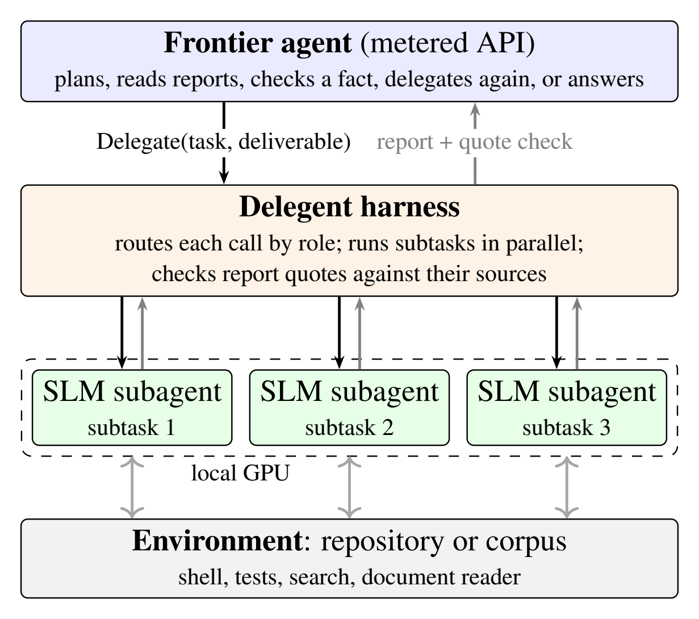

<h1 align="center">Delegent</h1>

<p align="center">
  <b>Let the frontier agent think. Let a local SLM do the legwork.</b>
</p>

<p align="center">
  <a href="LICENSE"></a>
  
  
  
</p>

Agents built on frontier models are expensive, because at every step the model re-reads its entire context. Much of
that work is legwork: locating code, reproducing a bug, running tests, issuing searches, reading documents.
**Delegent** keeps the frontier agent in charge of every task and hands this legwork to a small language model (SLM)
running on a GPU you control. The SLM never answers on its own. The frontier agent reads its short report, checks what
matters, and writes the final patch or answer. Nothing is trained, so either model can be swapped.

## Results

With GPT-6.1-Sol as the frontier agent, Delegent cuts the frontier model's bill on long-horizon coding to a third,
**with a 27B or even a 2B SLM**, and with no loss in task performance.

| Task set | Frontier agent alone | + Qwen3.8-27B-FP8 | + MiniCPM5-2B |
|:--|:-:|:-:|:-:|
| SWE-bench Verified (50 tasks) | 46 solved | 46 solved, **44%** cost | 47 solved, **53%** cost |
| SWE-bench Pro (75 tasks) | 63 solved | 63 solved, **37%** cost | 62 solved, **44%** cost |
| DeepSWE v1.1 (50 tasks) | 29 solved | 29 solved, **33%** cost | 30 solved, **34%** cost |
| Agentic search (694 questions) | 663 correct | 663 correct, **41%** cost | not evaluated |

<sub>Cost is the frontier model's cost at API prices with prompt caching, relative to the frontier agent alone in the
same harness. On DeepSWE it falls from $2.11 to $0.70 per task with Qwen3.8-27B-FP8 and to $0.71 with MiniCPM5-2B.
Even with Qwen3.8-27B-FP8 paid for at API prices, a DeepSWE task costs 38% of the frontier agent alone.</sub>

The savings grow with the legwork. The longer the frontier agent would work on a task by itself, the more of that work
moves to the SLM, down to about a quarter of the cost on tasks that take it more than 200 calls alone.

<p align="center">
  
  <br>
  <sub>Median frontier cost with Delegent relative to the frontier agent alone, per coding task, by how many calls the
  frontier agent makes on the task alone (350 task pairs, three coding sets, both SLMs).</sub>
</p>

## How it works

<p align="center">
  
</p>

Delegent is one harness with one rule: **calls from the agent in charge go to the frontier model, and every subtask
runs on the SLM.** Subtasks issued in the same turn run in parallel, each in its own tool loop with a fresh context,
and only their final reports reach the frontier agent, never their tool output.

- **Coding.** Claude Code runs unmodified. Its main agent talks to the frontier model, while its subagents and its small
  auxiliary model talk to the SLM. A short [instruction](src/delegent/instructions/coding.md), installed as a
  user-level `CLAUDE.md`, asks the frontier agent to delegate investigation and verification and to make every code
  change itself.
- **Agentic search.** The frontier agent gets a `Delegate` tool next to `search` and `get_document`, plus a short
  [instruction](src/delegent/instructions/search.md). An SLM subagent searches the same corpus in the research loop of
  [AREX-Turbo](https://huggingface.co/BAAI/AREX-Turbo) and reports an answer with evidence, and Delegent looks up every
  evidence line in the cited document before the report comes back.
- **Caching on both sides.** Frontier calls carry a stable prompt-cache key per conversation, and each SLM subagent is
  pinned to one vLLM replica, so its growing prefix stays cached there.

## Quick start

**1. Install.**

```bash
pip install git+https://github.com/castorini/Delegent.git
```

**2. Serve an SLM** with vLLM on your GPU.

```bash
vllm serve Qwen/Qwen3.8-27B-FP8 --served-model-name Qwen3.8-27B-FP8 --max-model-len 131072 \
  --kv-cache-dtype fp8 --enable-auto-tool-choice --tool-call-parser qwen3_coder --reasoning-parser qwen3
```

<details>
<summary>MiniCPM5-2B instead (fits on a laptop GPU)</summary>

```bash
vllm serve openbmb/MiniCPM5-2B --served-model-name openbmb/MiniCPM5-2B --max-model-len 131072 \
  --dtype bfloat16 --enable-auto-tool-choice --tool-call-parser minicpm5 --reasoning-parser deepseek_r1
```

</details>

**3. Code with Claude Code**, with the frontier model in charge and the SLM doing the legwork.

```bash
export OPENAI_API_KEY=...
delegent claude --frontier gpt-6.1-sol --slm http://localhost:8000 --slm-model Qwen3.8-27B-FP8
```

When Claude Code exits, Delegent prints the frontier cost of the session. For a Claude model in charge, pass
`--frontier claude-...` and set `ANTHROPIC_API_KEY` instead.

## Usage

### Coding

Everything after `--` goes to Claude Code. A headless run on one issue:

```bash
delegent claude --frontier gpt-6.1-sol --slm http://localhost:8000 --slm-model Qwen3.8-27B-FP8 -- \
  -p "Fix the failing test in tests/test_parser.py" --permission-mode bypassPermissions --max-turns 100
```

Several SLM replicas go in one comma-separated list, `--slm http://gpu0:8000,http://gpu1:8000`. To drive another
agent that speaks the Anthropic Messages API, run `delegent relay` on its own; it prints the environment to set.

### Agentic search

Questions are JSON lines with an `id` and a `question`.

```bash
# over the ClimbMix corpus (BM25 search API)
export CLIMBMIX_TOKEN=...
delegent search --frontier gpt-6.1-sol --slm http://localhost:8000 --slm-model Qwen3.8-27B-FP8 \
  --corpus climbmix --questions questions.jsonl --out runs/climbmix

# over your own documents
delegent index --corpus docs/ --out index/
delegent search --frontier gpt-6.1-sol --slm http://localhost:8000 --slm-model Qwen3.8-27B-FP8 \
  --corpus local --corpus-root docs/ --index index/ --questions questions.jsonl --out runs/local
```

Add `--no-delegate` to run the frontier agent alone as a baseline. Every answer lands in `<out>/questions/<id>.json`
with its frontier usage and delegations.

### Measuring cost

Every model call, frontier and SLM alike, is written to a usage ledger (`delegent-usage.jsonl`, or
`<out>/usage.jsonl` for search).

```bash
delegent cost delegent-usage.jsonl --prices gpt-6.1-sol=2,0.10,10
```

Prices are dollars per million uncached input, cached input and output tokens; reasoning tokens count as output.

## Reproducing the paper

[REPRODUCING.md](REPRODUCING.md) lists the models, limits and prompts behind the results above, and
[samples/](samples) holds the exact task and question ids.

<details>
<summary>Repository layout</summary>

| Path | Contents |
|:--|:--|
| `src/delegent/relay.py` | the relay: Anthropic Messages API in, routing by role, one usage ledger |
| `src/delegent/frontier.py` | frontier backends: OpenAI Responses (with the Anthropic translation) and Anthropic |
| `src/delegent/slm.py` | SLM backend: vLLM replicas, conversation pinning, window clamping |
| `src/delegent/delegate.py` | the `Delegate` tool, the SLM search subagent and the evidence check |
| `src/delegent/agent.py` | the search agent loop |
| `src/delegent/corpus.py`, `bm25.py` | ClimbMix client and local BM25 index |
| `src/delegent/instructions/` | the coding and search instructions |
| `samples/` | task and question ids of the paper's evaluation |
| `tests/` | offline tests with fake model servers (`pytest`) |

</details>

## License

Apache 2.0. The SLM search subagent uses the prompts and tool schemas of
[AREX-Turbo](https://huggingface.co/BAAI/AREX-Turbo), also Apache 2.0; see [NOTICE](NOTICE).
