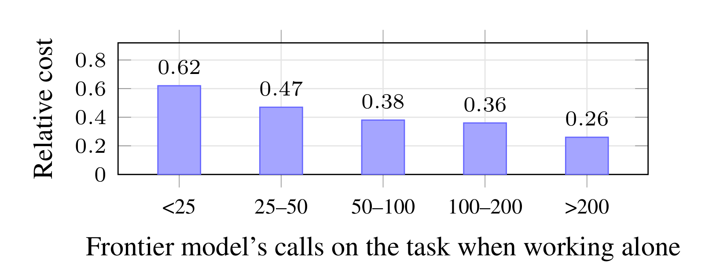

<h1 align="center">delegent</h1>

<p align="center">
  <b>A multi-agent harness that reduces cost without sacrificing performance.</b><br>
  Built on Claude Code. The frontier model leads; a small language model on your own GPU does the legwork.
</p>

<p align="center">
  <a href="LICENSE"></a>
  
  
  
</p>

<table align="center">
  <tr>
    <td align="center"><h2>33%</h2>frontier cost on<br>long-horizon coding<br><sub>DeepSWE, 27B FP8 SLM</sub></td>
    <td align="center"><h2>41%</h2>frontier cost on<br>agentic search<br><sub>694 questions, 27B FP8 SLM</sub></td>
    <td align="center"><h2>34%</h2>with a 2B SLM<br>that fits on a laptop<br><sub>DeepSWE, MiniCPM5-2B</sub></td>
    <td align="center"><h2>No loss</h2>in solved tasks<br>or correct answers<br><sub>nothing is trained</sub></td>
  </tr>
</table>

Agents built on frontier models are expensive, because at every step the model re-reads its entire context. Much of
that work is legwork: locating code, reproducing a bug, running tests, issuing searches, reading documents.
**delegent** keeps the frontier model in charge of every task and hands this legwork to a small language model (SLM)
running on a GPU you control. The SLM never answers on its own. The frontier model reads its short report, checks what
matters, and writes the final patch or answer. Nothing is trained, so either model can be swapped.

**Contents:** [How it works](#how-it-works) · [Results](#results) · [Requirements](#requirements) ·
[Quick start](#quick-start) · [Usage](#usage) · [Reference](#reference) · [Troubleshooting](#troubleshooting) ·
[Security and privacy](#security-and-privacy) · [Development](#development) ·
[For coding agents](#for-coding-agents) · [Reproducing the paper](#reproducing-the-paper) · [Citation](#citation) ·
[License](#license)

## How it works

<p align="center">
  
  <br>
  <sub>delegent starts from stock Claude Code, and everything in orange is what it adds. The user talks to the main
  loop, where the frontier model leads the task and spawns subagents. The loops share most tools, and each has a few of
  its own.</sub>
</p>

delegent is one harness with one rule: **calls from the main loop go to the frontier model, and every subtask runs on
the SLM.** Subtasks issued in the same turn run in parallel, each in its own tool loop with a fresh context, and only
their final reports reach the frontier model, never their tool output. On top of stock Claude Code, delegent adds:

- **A relay that routes model calls by role.** Claude Code's main loop talks to the frontier model, while its subagents
  and its small auxiliary model talk to the SLM. The frontier model can be an OpenAI or an Anthropic model.
- **One short instruction.** The [instruction](src/delegent/instructions/delegent.md) tells the frontier model what to
  delegate and to keep its own tool use to a few targeted checks. For coding, it is installed as a user-level
  `CLAUDE.md` and asks the frontier model to delegate investigation and verification and to make every code change
  itself.
- **Search tools and a `Delegate` tool.** For agentic search, the frontier model gets `search`, `get_document` and
  `Delegate`. A delegated SLM subagent searches the same corpus with `search` and `visit` and reports an answer with
  evidence.
- **A quote check.** Before a search report comes back, delegent looks up every evidence line in the cited document
  and notes whether it was found verbatim.
- **Caching on both sides.** Frontier calls carry a stable prompt-cache key per conversation, and each SLM subagent is
  pinned to one vLLM replica, so its growing prefix stays cached there.

## Results

All numbers are from our paper, with GPT-6.1-Sol at high reasoning effort as the frontier model, run in the same
harness with and without delegation. Cost is the frontier model's cost at API prices with prompt caching.

### Long-horizon coding

| Task set | Frontier model alone | + Qwen3.8-27B-FP8 | + MiniCPM5-2B |
|:--|:-:|:-:|:-:|
| SWE-bench Verified (50 tasks) | 46 solved, $0.244 | 46 solved, **44%** cost | 47 solved, **53%** cost |
| SWE-bench Pro (75 tasks) | 63 solved, $0.617 | 63 solved, **37%** cost | 62 solved, **44%** cost |
| DeepSWE v1.1 (50 tasks) | 29 solved, $2.110 | 29 solved, **33%** cost | 30 solved, **34%** cost |

<sub>Dollar amounts are frontier cost per task. On DeepSWE it falls from $2.11 to $0.70 with Qwen3.8-27B-FP8 and to
$0.71 with MiniCPM5-2B. Even with Qwen3.8-27B-FP8 paid for at API prices, a DeepSWE task costs 38% of the frontier
model alone.</sub>

### Agentic search

| Dataset | Frontier model alone | + Qwen3.8-27B-FP8 |
|:--|:-:|:-:|
| BrowseComp-Plus, own corpus (200) | 193 correct, $0.114 | 192 correct, **63%** cost |
| BrowseComp-Plus (80) | 72 correct, $0.211 | 71 correct, **31%** cost |
| Total Recall QA (68) | 64 correct, $0.048 | 67 correct, **31%** cost |
| HotpotQA (204) | 198 correct, $0.033 | 198 correct, **25%** cost |
| DeepSearchQA, find one (71) | 70 correct, $0.067 | 70 correct, **29%** cost |
| DeepSearchQA, find all (71) | 66 correct, $0.121 | 65 correct, **26%** cost |
| **All (694)** | **663 correct, $0.091** | **663 correct, 41% cost** |

<sub>Dollar amounts are frontier cost per question. All datasets except the first are from the CMASS suite over the
ClimbMix corpus, searched with BM25.</sub>

### The savings grow with the legwork

The longer the frontier model would work on a task by itself, the more of that work moves to the SLM, down to about a
quarter of the cost on tasks that take it more than 200 calls alone.

<p align="center">
  
  <br>
  <sub>Median frontier cost with delegent relative to the frontier model alone, per coding task, by how many calls the
  frontier model makes on the task alone (350 task pairs, three coding sets, both SLMs).</sub>
</p>

### Two frontier models

The frontier model behind delegent can change freely. On DeepSWE, we also ran Claude Opus 5.5 at xhigh effort.

| Per DeepSWE task (50 tasks) | GPT-6.1-Sol | Claude Opus 5.5 |
|:--|:-:|:-:|
| How it works alone | long loop of edit, test, fix | plans first, then acts |
| Solved alone | 29 | 34 |
| Solved with an SLM | 29.5 | 38 |
| Frontier cost with an SLM | **34%** | **69%** |

<sub>With an SLM, values average the two SLMs. delegent saves the most for a frontier model that would otherwise do
much of the legwork itself.</sub>

## Requirements

| What | Needed for | Notes |
|:--|:--|:--|
| Python 3.10 or later | everything | the only Python dependencies are `requests` and `numpy` |
| An SLM behind [vLLM](https://docs.vllm.ai) | everything | one GPU per replica; the commands in the quick start serve the two SLMs of the paper |
| A frontier model API key | `delegent claude`, `delegent search`, `delegent run` | `OPENAI_API_KEY` for GPT models, `ANTHROPIC_API_KEY` for Claude models |
| [Claude Code](https://code.claude.com/docs) (`claude` on your `PATH`) | coding | the paper used 2.1.232; the integrations were tested with 2.1.325 |
| [Codex](https://github.com/openai/codex) (`codex` on your `PATH`) | `delegent install codex` only | tested with 0.162.1 |
| A ClimbMix search endpoint | `--corpus climbmix` only | `CLIMBMIX_API` and `CLIMBMIX_TOKEN`; your own documents need nothing beyond `delegent index` |

delegent runs on Linux and macOS. The SLM can be on another machine: `--slm` takes any reachable vLLM URL.

## Quick start

**1. Install.**

```bash
pip install git+https://github.com/castorini/delegent.git
# or, from a downloaded copy of this repository
pip install .
```

For coding, also install [Claude Code](https://code.claude.com/docs). delegent builds its coding harness around your
Claude Code installation: the relay takes Claude Code's model calls (through Claude Code's documented
`ANTHROPIC_BASE_URL` setting) and sends the main loop's calls to the frontier model and the subagents' calls to the
SLM, and the delegation instruction is added as a user-level `CLAUDE.md` in a separate config directory, so your own
Claude Code settings are untouched. delegent does not bundle Claude Code, and your use of Claude Code
remains subject to Anthropic's terms.

**2. Serve an SLM** with vLLM on your GPU.

```bash
vllm serve Qwen/Qwen3.8-27B-FP8 --served-model-name Qwen3.8-27B-FP8 --max-model-len 131072 \
  --kv-cache-dtype fp8 --enable-auto-tool-choice --tool-call-parser qwen3_coder --reasoning-parser qwen3
```

<details>
<summary>MiniCPM5-2B instead (fits on a laptop GPU)</summary>

```bash
vllm serve openbmb/MiniCPM5-2B --served-model-name openbmb/MiniCPM5-2B --max-model-len 131072 \
  --dtype bfloat16 --enable-auto-tool-choice --tool-call-parser minicpm5 --reasoning-parser deepseek_r1
```

</details>

**3. Code with Claude Code**, with the frontier model in charge and the SLM doing the legwork.

```bash
export OPENAI_API_KEY=...
delegent claude --frontier gpt-6.1-sol --slm http://localhost:8000 --slm-model Qwen3.8-27B-FP8
```

When Claude Code exits, delegent prints the frontier cost of the session. For a Claude model in charge, pass
`--frontier claude-...` and set `ANTHROPIC_API_KEY` instead.

## Usage

### Coding

Everything after `--` goes to Claude Code. A headless run on one issue:

```bash
delegent claude --frontier gpt-6.1-sol --slm http://localhost:8000 --slm-model Qwen3.8-27B-FP8 -- \
  -p "Fix the failing test in tests/test_parser.py" --permission-mode bypassPermissions --max-turns 100
```

Several SLM replicas go in one comma-separated list, `--slm http://gpu0:8000,http://gpu1:8000`. To drive another
agent that speaks the Anthropic Messages API, run `delegent relay` on its own; it prints the environment to set.

### Agentic search

Questions are JSON lines with an `id` and a `question`.

```bash
# over the ClimbMix corpus (BM25 search API)
export CLIMBMIX_API=...     # base URL of your ClimbMix search endpoint
export CLIMBMIX_TOKEN=...
delegent search --frontier gpt-6.1-sol --slm http://localhost:8000 --slm-model Qwen3.8-27B-FP8 \
  --corpus climbmix --questions questions.jsonl --out runs/climbmix

# over your own documents
delegent index --corpus docs/ --out index/
delegent search --frontier gpt-6.1-sol --slm http://localhost:8000 --slm-model Qwen3.8-27B-FP8 \
  --corpus local --corpus-root docs/ --index index/ --questions questions.jsonl --out runs/local
```

Add `--no-delegate` to run the frontier model alone as a baseline. Every answer lands in `<out>/questions/<id>.json`
with its frontier usage and delegations.

### Measuring cost

Every model call, frontier and SLM alike, is written to a usage ledger (`delegent-usage.jsonl`, or
`<out>/usage.jsonl` for search).

```bash
delegent cost delegent-usage.jsonl --prices gpt-6.1-sol=2,0.10,10
```

Prices are dollars per million uncached input, cached input and output tokens; reasoning tokens count as output.

### Optional extras

None of these is needed to reproduce the paper, which runs coding and search in separate loops as above.

#### Inside your own Claude Code or Codex

`delegent claude` is a launcher: it starts Claude Code with its own configuration and its own frontier backend. If you
would rather keep the agent you already use, with your own login, settings and frontier model, install delegent into
it. Both integrations follow the same rule as the launcher, routed by the same relay: the main loop keeps your
frontier model, and every subagent runs on the SLM.

```bash
# Claude Code: afterwards, run `claude` as usual
delegent install claude --slm http://localhost:8000 --slm-model Qwen3.8-27B-FP8

# Codex: afterwards, start the relay and run Codex with the profile
delegent install codex --slm http://localhost:8000 --slm-model Qwen3.8-27B-FP8
delegent serve --slm http://localhost:8000 --slm-model Qwen3.8-27B-FP8
codex -p delegent
```

To give the agent search as well, add a corpus to the same command. The session then also has `search`,
`get_document` and `Delegate`, whose SLM subagent searches the corpus in its own loop and returns a report with checked
evidence, and the instruction covers both kinds of delegation. This is what `--corpus` adds to `delegent claude`.

```bash
delegent install claude --slm http://localhost:8000 --slm-model Qwen3.8-27B-FP8 \
  --corpus local --corpus-root docs/ --index index/      # or --corpus climbmix
```

`delegent uninstall claude` and `delegent uninstall codex` remove exactly what was added.

| | Claude Code | Codex |
|:--|:--|:--|
| What is installed | Three `env` entries in `settings.json`, the coding instruction in your user-level `CLAUDE.md`, and a `SessionStart` hook that starts the relay | A profile, `delegent.config.toml`, and a copy of Codex's model catalog with the SLM added; your `config.toml` is not edited |
| Main loop | Your Claude model with your own login or API key, passed through unchanged | Your OpenAI model with your API key (`OPENAI_API_KEY`), passed through unchanged |
| Subagents | Claude Code's own subagents (the Agent tool), on the SLM | Codex's own subagents (`spawn_agent`), on the SLM by default |
| Instruction | The same text as `delegent claude` | The same text, with Codex's tool names |
| Search (with `--corpus`) | `search`, `get_document` and `Delegate` as an MCP server, as in the merged mode | The same MCP server; Codex finds the tools through its tool search |
| Relay | Starts with the session | Starts with the session when installed with `--corpus`; otherwise run `delegent serve` |

The relay (`delegent serve`) serves only the calls that name the SLM. Every other request goes to the Anthropic or
OpenAI API exactly as your agent sent it, with your agent's own credentials, and the answer comes back byte for byte.
With a corpus, it also serves the search tools, and `Delegate` runs the same subagent loop and evidence check as
`delegent search`. It listens on `127.0.0.1:8787` and writes the usage of both models to `~/.delegent/usage.jsonl`,
which `delegent cost` reads.

**What to expect.** In Claude Code, the integration runs the same code as `delegent claude` for everything that
matters to the result: the same Claude Code agent loop and Agent tool, the same roles for the SLM, the same relay code
for SLM calls (token counting, window clamping, replica pinning) and the same instruction. What differs is around it:
the frontier model is a Claude model, for which the paper measured a smaller saving than for GPT-6.1-Sol (see
[Two frontier models](#two-frontier-models)), and your own `CLAUDE.md`, plugins and MCP servers stay in the context.
In Codex, the rule and the instruction are the same, but the agent loop, tools and subagents are Codex's own, which the
paper did not evaluate.

We tested both integrations end to end with the real CLIs (Claude Code 2.1.325, Codex 0.162.1) against scripted model
servers, on a coding task and on a search question: the main loop's calls pass through with the agent's own
credentials, a spawned subagent's calls reach the SLM, a `Delegate` call runs the search subagent on the SLM, and the
reports return to the main loop. In Claude Code, the same scripted runs through `delegent claude` gave the same
sequence of model calls, the same subagent conversations and the same `Delegate` report. We have not benchmarked the
integrations. For Codex, your vLLM version must serve the OpenAI Responses API, and signing in with ChatGPT instead of
an API key (`--openai-auth`) is untested. As in the merged mode below, search inside a coding agent costs more than
the separate search loop of `delegent search`. Anthropic does not officially support routing Claude Code's calls to
non-Claude models through a gateway, which applies to `delegent claude` as well.

#### One command that picks the loop

`delegent run` is a small convenience on top of `delegent claude` and `delegent search`. By default it picks the loop
from what the task comes with: a repository means coding, a corpus means search, and both mean one session in the
merged mode below. With `--pick-by model`, the frontier
model reads the task first and says whether it is a coding task or a search question, at the cost of one short call.

```bash
delegent run --frontier gpt-6.1-sol --slm http://localhost:8000 --slm-model Qwen3.8-27B-FP8 \
  --task "Fix the failing test in tests/test_parser.py" --repo path/to/repo
delegent run --frontier gpt-6.1-sol --slm http://localhost:8000 --slm-model Qwen3.8-27B-FP8 \
  --task "Which 1990s film ...?" --corpus climbmix --pick-by model
```

#### One session for coding and search

By default the two uses run in separate loops. For a session that alternates between coding and search, or a task that
needs both, add `--corpus` to `delegent claude`: the same Claude Code session then also gets `search`, `get_document`
and `Delegate` over that corpus (served to Claude Code over MCP), and its instruction covers both kinds of delegation.

```bash
delegent claude --frontier gpt-6.1-sol --slm http://localhost:8000 --slm-model Qwen3.8-27B-FP8 \
  --corpus local --corpus-root docs/ --index index/
```

On pure search, the separate search loop is cheaper. On 80 BrowseComp-Plus questions over ClimbMix, with GPT-6.1-Sol and
Qwen3.8-27B-FP8:

| Main loop | Correct | Frontier cost | Frontier calls per question |
|:--|:-:|:-:|:-:|
| Search loop, frontier model alone | 73 / 72 (two runs) | 100% | 15.0 / 13.9 |
| Search loop, with `Delegate` (default) | 71 | **33%** | 6.2 |
| Claude Code, frontier model alone | 73 | 180% | 27.2 |
| Claude Code, with `Delegate` (merged mode) | 71 | 108% | 14.4 |

<sub>Cost is relative to the search loop with the frontier model alone. The merged mode keeps accuracy and still roughly
halves Claude Code's own cost on search, but Claude Code's main loop makes about twice as many calls as the search loop,
and delegated searches in it took longer (median 747 s per question).</sub>

## Reference

### Commands

Every command is non-interactive: it reads its arguments and environment, never prompts, and `delegent <command>
--help` lists all options.

| Command | What it does |
|:--|:--|
| `delegent claude` | starts Claude Code through the relay, with the instruction; arguments after `--` go to Claude Code |
| `delegent search` | answers a file of questions with the search loop; writes one JSON file per question |
| `delegent run` | picks coding or search for one task, then runs it as `claude` or `search` would |
| `delegent index` | builds a BM25 index over a directory of documents |
| `delegent cost` | prints the calls and the frontier cost of a usage ledger |
| `delegent relay` | serves the relay on its own, for another agent that speaks the Anthropic Messages API |
| `delegent install claude\|codex` | sets up your own Claude Code or Codex (see [above](#inside-your-own-claude-code-or-codex)) |
| `delegent uninstall claude\|codex` | removes what `install` added |
| `delegent serve` | the relay for an installed agent; `--ensure` starts it in the background if it is not running |
| `delegent mcp` | the search tools over stdio; started by the installed agent, not by you |

Exit status: 0 on success. A setup problem (a missing program, an unreachable port, an invalid corpus) exits with a
non-zero status and one line on stderr that starts with `delegent:`. `delegent claude` exits with Claude Code's own
status. `delegent search` exits 0 even when single questions fail: a failed question is written as
`{"id": ..., "error": ...}`, and a rerun skips every question that already has a file, so delete the files with an
`error` to retry them.

### Configuration

Models and endpoints are command-line options. The environment holds credentials and a few overrides.

| Variable | Used by | Meaning |
|:--|:--|:--|
| `OPENAI_API_KEY` | launcher, search | key for a GPT frontier model |
| `ANTHROPIC_API_KEY` | launcher, search | key for a Claude frontier model |
| `DELEGENT_SLM_API_KEY` | everything | key sent to vLLM, if yours requires one (default `EMPTY`) |
| `DELEGENT_QWEN_EFFORT` | coding | reasoning effort of a Qwen SLM (default `medium`) |
| `CLIMBMIX_API`, `CLIMBMIX_TOKEN` | `--corpus climbmix` | base URL and token of the ClimbMix search endpoint; `CLIMBMIX_TOKEN_FILE` reads the token from a file |
| `CLIMBMIX_CACHE` | `--corpus climbmix` | where searches and documents are cached (default `~/.cache/delegent/climbmix`) |
| `DELEGENT_OPENAI_URL`, `DELEGENT_ANTHROPIC_URL` | launcher, search | full URL of the frontier API, to go through your own gateway |
| `DELEGENT_OPENAI_API` | `delegent serve` | base URL that Codex's own calls pass through to (also `--openai-upstream`) |
| `CLAUDE_CONFIG_DIR`, `CODEX_HOME` | `install`, `uninstall` | the agent's config directory, if not `~/.claude` or `~/.codex` (also `--config-dir`) |

### Files delegent writes

| File | Written by | Contents |
|:--|:--|:--|
| `delegent-usage.jsonl` (or `--ledger`) | `claude`, `run`, `relay` | the usage ledger, one JSON line per model call |
| `<out>/usage.jsonl`, `<out>/questions/<id>.json` | `search` | the ledger and one result per question |
| `~/.delegent/usage.jsonl`, `~/.delegent/serve.log` | `serve` | the ledger and the log of a relay started in the background |
| `~/.cache/delegent/climbmix/` | `--corpus climbmix` | cached searches and documents |

A ledger line has `time`, `role` (`frontier` or `slm`), `model`, `seconds`, `input_tokens` (cached tokens included),
`cached_input_tokens` and `output_tokens`, plus `error` when the call failed and `subtask: true` for the SLM usage of
one delegated search. A search result has `id`, `question`, `answer`, `frontier_calls`, `frontier_input_tokens`,
`frontier_cached_tokens`, `frontier_output_tokens`, `seconds`, `slm_calls`, `delegations` (one entry per `Delegate`
call, with its task, report and SLM usage) and `actions` (one entry per frontier step).

The relay answers `GET /health` with `{"ok": true, ...}`, which is how to check that it is up.

## Troubleshooting

| Symptom | Cause and fix |
|:--|:--|
| `Claude Code (claude) not found` | install Claude Code, or pass `--claude-bin` |
| `OPENAI_API_KEY is not set` (or `ANTHROPIC_API_KEY`) | export the key of the frontier model you named with `--frontier` |
| `SLM rejected the request` with a tool-calling error | start vLLM with `--enable-auto-tool-choice` and the tool-call parser of your model, as in the quick start |
| Claude Code prints `[claude-code:unrecognized_model]` for the SLM | expected: Claude Code does not know the SLM's name; the call still goes to the SLM |
| `cannot listen on http://127.0.0.1:8787` | another program uses the port; pass `--port` to `install` and `serve` |
| `the relay did not start` | read `~/.delegent/serve.log`; usually the SLM endpoint or the corpus path is wrong |
| Claude Code cannot reach its model after `delegent install claude --no-autostart` | the relay is not running: start `delegent serve`, or run `delegent uninstall claude` |
| `already sets ANTHROPIC_BASE_URL` | your Claude Code already goes through a gateway; `--force` replaces it |
| `this Codex version did not accept the profile or the SLM catalog entry` | Codex changed its catalog format; nothing was installed. Please open an issue with your Codex version |
| The agent does not list `Delegate` | current Claude Code and Codex load MCP tools on demand; check that the `corpus` server is connected with `claude mcp list` or `codex -p delegent mcp list` |
| `set CLIMBMIX_API to the base URL of a ClimbMix search endpoint` | `CLIMBMIX_API` is not a URL |

## Security and privacy

- **The relay listens on `127.0.0.1` only.** The launcher's relay also requires a random token that only its own
  Claude Code session knows. The relay of an installed agent (`delegent serve`) has no token, so any program on your
  machine can send requests to your SLM through it; requests for other models still need their own credentials.
- **Credentials are not stored or logged.** An installed agent's requests to Anthropic or OpenAI are forwarded with
  the agent's own headers and nothing is kept. The ledger holds token counts and model names, not prompts or keys.
- **Subtasks go to your SLM in full.** A coding subagent sees the files and command output it works with, as it would
  on the frontier model. Search results keep the questions, answers and delegated tasks under `--out`.
- **The SLM runs tools.** A coding subagent is a Claude Code or Codex subagent with that agent's tools and
  permissions, so the usual care with `--permission-mode bypassPermissions` applies to it as well.

## Development

```bash
git clone https://github.com/castorini/delegent.git
cd delegent
pip install -e ".[test]"
pytest
```

The tests are offline: fake model servers stand in for the frontier API and for vLLM, so they need no GPU, no key and
no network. Bug reports and pull requests are welcome on [GitHub](https://github.com/castorini/delegent/issues); please
include the command you ran, your Claude Code or Codex version, and the `delegent:` line or traceback you got.

## For coding agents

If you are an AI agent working with this repository, [AGENTS.md](AGENTS.md) has the short version: how to set up and
test, where things are, and what not to change. The facts an agent most often needs:

- Every command is non-interactive and documented by `delegent <command> --help`.
- To run a coding task headlessly, use `delegent claude ... -- -p "<task>" --permission-mode bypassPermissions`; the
  final answer is on stdout and the cost summary on stderr.
- To answer questions, use `delegent search`; read results from `<out>/questions/<id>.json`, not from stdout.
- To check that a relay is up, `GET /health`. To read spending, `delegent cost <ledger>`.
- `delegent install` changes the user's own agent configuration. Run it only when the user asks for it, and prefer
  `--config-dir` on a scratch directory when you only want to test.

## Reproducing the paper

[REPRODUCING.md](REPRODUCING.md) lists the models, limits and prompts behind the results above, and
[samples/](samples) holds the exact task and question ids.

<details>
<summary>Repository layout</summary>

| Path | Contents |
|:--|:--|
| `src/delegent/relay.py` | the relay: Anthropic Messages API in, routing by role, one usage ledger; attached (`delegent serve`), it passes the agent's own calls through |
| `src/delegent/frontier.py` | frontier backends: OpenAI Responses (with the Anthropic translation) and Anthropic |
| `src/delegent/slm.py` | SLM backend: vLLM replicas, conversation pinning, window clamping |
| `src/delegent/delegate.py` | the `Delegate` tool, the SLM search subagent and the evidence check |
| `src/delegent/agent.py` | the search agent loop |
| `src/delegent/mcp.py` | corpus tools and `Delegate` over MCP, for the merged mode and the integrations |
| `src/delegent/install.py` | optional: `delegent install claude\|codex`, delegent inside your own agent |
| `src/delegent/corpus.py`, `bm25.py` | ClimbMix client and local BM25 index |
| `src/delegent/instructions/delegent.md` | the instruction for coding and search |
| `samples/` | task and question ids of the paper's evaluation |
| `tests/` | offline tests with fake model servers (`pytest`) |
| `AGENTS.md`, `CLAUDE.md` | guidance for coding agents working in this repository |

</details>

## Citation

If you use delegent, please cite our paper:

```bibtex
@article{gu2026delegent,
  title   = {Delegent: A Multi-Agent Harness That Reduces Cost without Sacrificing Performance},
  author  = {Gu, Lingwei and Lin, Jimmy},
  journal = {arXiv preprint},
  year    = {2026}
}
```

## License

Apache 2.0. The SLM search subagent reuses the prompts and tool definitions of
[AREX-Turbo](https://huggingface.co/BAAI/AREX-Turbo) (Apache 2.0); see [NOTICE](NOTICE).
